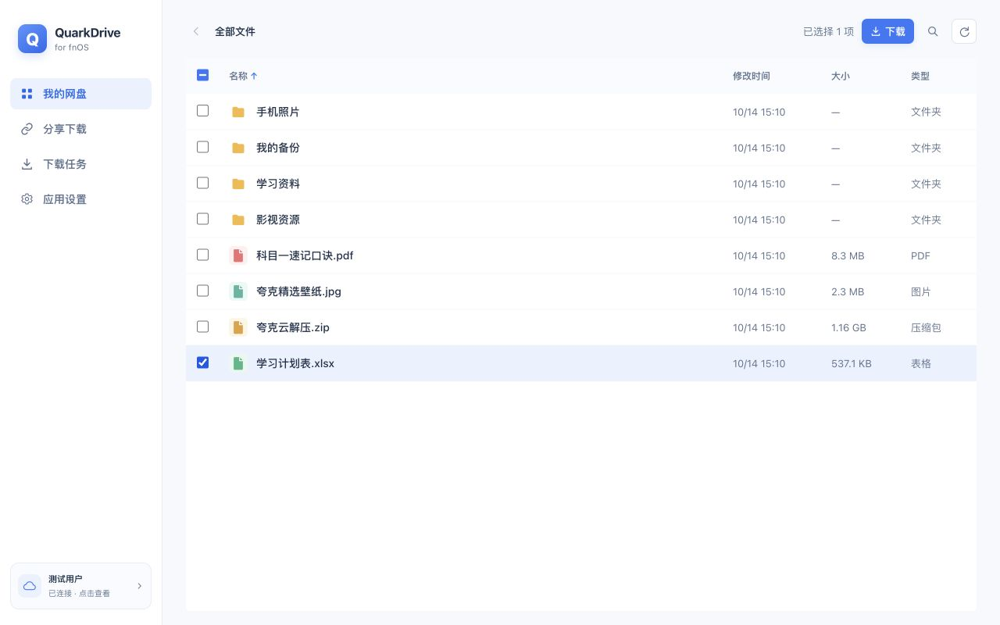
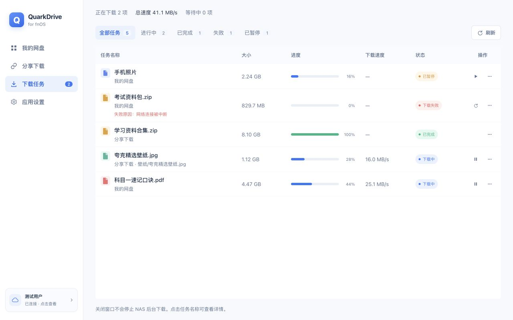
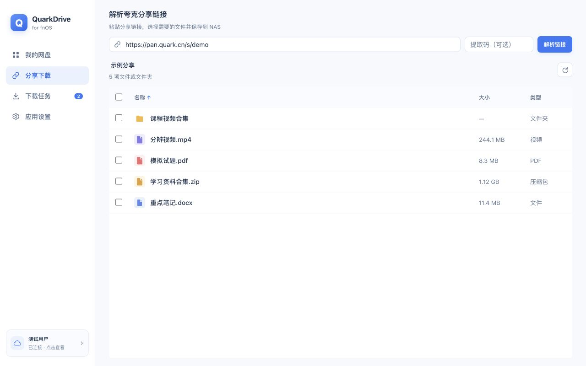
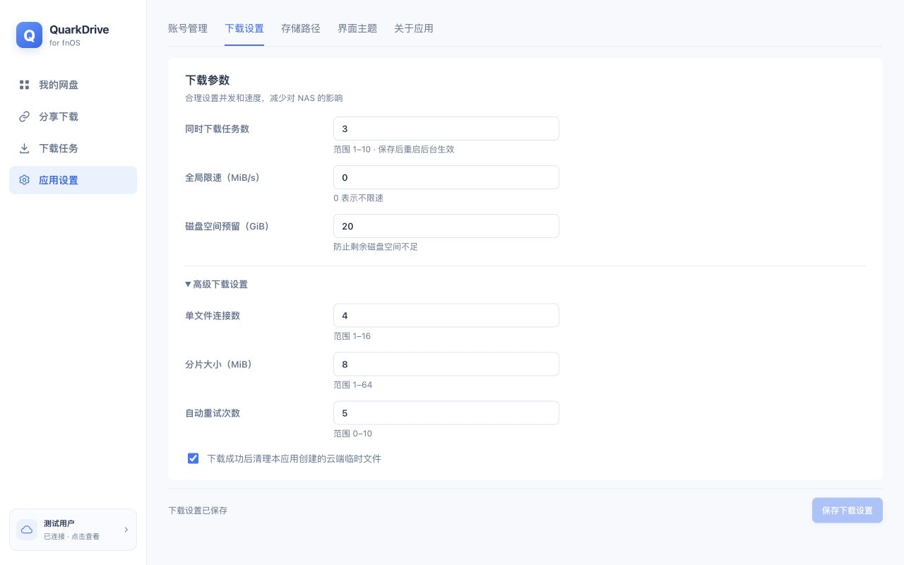

# QuarkDrive for fnOS

**飞牛 fnOS 原生夸克网盘下载器**

浏览个人网盘、解析分享链接，将文件直接下载到 NAS。

[下载安装](https://github.com/chenpingonline/quark-for-fnos/releases) · [界面预览](#界面预览) · [使用说明](#使用说明) · [更新记录](CHANGELOG.md) · [问题反馈](https://github.com/chenpingonline/quark-for-fnos/issues)

## 项目简介

QuarkDrive 是面向飞牛 fnOS 的第三方夸克网盘下载工具。使用夸克 App 扫码登录后，可浏览个人网盘、选择分享文件，并由 NAS 在后台完成下载。

应用提供 x86_64 和 ARM64 原生 FPK，运行时无需 Docker 或额外安装 Node.js、Python、Redis、aria2。关闭应用页面后，后台下载仍会继续。

> [!NOTE]
> 当前为实验性预发布版本，非夸克官方应用，需要有效夸克账号。夸克接口与服务策略可能变化；完整飞牛真机验收尚未完成，验证范围见 [工程状态](docs/STATUS.md)。

## 主要功能

| 模块 | 说明 |
| --- | --- |
| 账号管理 | 扫码登录、账号状态检查、退出登录，凭据在本地加密保存 |
| 个人网盘 | 目录浏览、文件搜索、名称/时间/大小排序，支持批量选择和文件夹递归下载 |
| 分享下载 | 解析链接与提取码，浏览分享目录并选择需要下载的内容 |
| 下载任务 | 后台队列、任务筛选、多选批量开始/暂停、失败重试、任务清理、详情与错误原因 |
| 分片与续传 | HTTP Range 并发下载、已完成分片续传，分片与完整文件 SHA-256 校验 |
| 进度与速度 | 每秒刷新任务，按持续传输字节计算最近四秒平均速度 |
| 下载设置 | 任务并发、单文件连接数、分片大小、限速、自动重试、磁盘空间预留及授权下载目录 |
| 界面交互 | 文件夹单击进入、目录文件单页滚动查看、按需展开搜索，支持浅色/深色主题及窄窗口布局 |

自动主题通过飞牛官方 SDK 读取并监听 fnOS 主题，需 fnOS 1.2.0401 或更新版本；独立浏览器或接口不可用时使用浏览器主题，设置页会显示实际主题来源。手动选择浅色/深色时，以手动选择为准。

## 界面预览

截图统一使用浅色主题，来自当前应用的本地预览。账号、文件、分享链接和任务均为示例数据，截图速度不代表实际下载性能。

### 我的网盘

下载任务

分享下载

应用设置

## 安装

### 环境要求

- 飞牛 fnOS：安装包声明的最低版本为 **1.1.3100**，具体设备兼容性需实测。
- CPU：**x86_64 / amd64** 或 **ARM64 / aarch64**。
- 使用飞牛管理员账号安装和访问应用，并授权下载目录。
- NAS 能够连接夸克服务，已准备有效夸克账号。

### 选择安装包

前往 [GitHub Releases](https://github.com/chenpingonline/quark-for-fnos/releases)，按 NAS 架构选择对应 FPK；实验性版本标记为 **Pre-release**。

| 设备架构 | 安装包 |
| --- | --- |
| Intel / AMD 64 位 | `QuarkDrive_<版本>_x86_64.fpk` |
| ARM 64 位 | `QuarkDrive_<版本>_arm64.fpk` |

### 安装步骤

1. 下载对应架构的 FPK。
2. 打开飞牛 **应用中心 → 手动安装**，选择安装包。
3. 按系统提示完成安装与共享目录授权。
4. 从飞牛桌面打开 **QuarkDrive**，使用夸克 App 扫码登录。

升级时选择更高版本、相同架构的 FPK，通过应用中心升级。升级流程设计为保留应用数据和下载目录；重要数据请提前备份。

## 使用说明

### 下载个人网盘文件

在 **我的网盘** 单击进入文件夹，勾选文件或文件夹，点击顶部 **下载**，选择已授权的 NAS 目录并确认。目录内容自动合并到同一列表，可直接滚动查看；点击搜索图标展开输入框，输入关键词后按 Enter 搜索。

### 下载分享文件

在 **分享下载** 粘贴链接，按需填写提取码并点击 **解析链接**。浏览目录、勾选内容后点击 **下载**，确认保存位置。

分享文件会先转存到账号的 `QuarkDriveTemp` 临时目录。启用自动清理后，仅在下载成功后删除本应用转存的对应文件；失败或中断时保留云端副本。

### 管理任务与设置

在 **下载任务** 查看进度、速度、失败原因和任务详情，使用暂停、继续或重试操作；勾选任务后可在顶部批量开始下载、暂停或清理选中记录。清理已完成或失败任务时，默认仅清理记录；也可选择同时删除 NAS 本机文件，文件将直接删除，不经过回收站。下载目录、并发、限速、重试和空间预留在 **应用设置** 中调整；“同时下载任务数”修改后需重启应用后台服务才能按新并发数调度。

### 数据保存

| 数据 | 位置与处理方式 |
| --- | --- |
| 应用状态与登录凭据 | `$TRIM_PKGVAR/data`；凭据使用 AES-256-GCM 与本地密钥加密，拥有 NAS root 权限仍可读取本机数据与密钥 |
| 下载文件 | 飞牛授权给应用的共享目录，不接受任意未授权绝对路径 |
| 临时文件与断点 | 下载目录下的 `.quarkdrive-part/`；需要续传时不要删除 |

## 常见问题

### 速度变化时，为什么进度可能暂时不变？

速度按持续传输字节计算最近四秒平均值；分片下载进度和断点记录在分片写盘、同步并校验后更新，因此二者不一定同时变化。持续无数据时速度逐步降至 `0 B/s`，暂停或完成后显示 `—`。

### 下载是否都能断点续传？

支持 HTTP Range 的来源可使用已完成分片续传。不支持 Range 时会降级为单连接下载，当前该降级模式中断后从头开始。

### 下载失败或出现 HTTP 400 怎么办？

查看任务详情中的失败阶段和错误码。应用已适配桌面客户端下载请求，但账号权益、限速、空间、风控及地址有效期仍由夸克服务决定。项目不提供账号、会员权益或下载线路。

反馈时请附上应用版本、NAS 架构、操作步骤和脱敏后的错误信息，勿公开 Cookie、扫码凭据或带签名的下载地址。

## 开发文档

前端采用原生 HTML / CSS / JavaScript，后端采用 Go，应用状态使用原子写入的 JSON。构建工具与验证命令见开发指南。

| 文档 | 内容 |
| --- | --- |
| [开发指南](docs/DEVELOPMENT.md) | 技术结构、构建依赖、本地预览与源码目录 |
| [打包规范](docs/PACKAGING.md) | 版本源、官方 fnpack、架构分包、生命周期与包内审计 |
| [HTTP API](docs/API.md) | 应用接口说明 |
| [工程状态](docs/STATUS.md) | 已验证内容、实现边界和后续事项 |
| [需求审计](docs/REQUIREMENTS_AUDIT.md) | 原始需求与当前实现的差异 |
| [手动验收](docs/manual-acceptance.md) | 真实设备、账号与下载流程验收清单 |
| [安全说明](docs/security.md) | 凭据、权限与安全边界 |
| [更新记录](CHANGELOG.md) | 历史版本与开发阶段变更 |

本地检查包含 Go 测试、race/vet、前端语法及主题/列表测试、模拟 API 浏览器流程和官方打包审计；ARM64 隔离 Linux 容器覆盖启停、资源路由与数据保留。上述检查不替代真实 fnOS 安装升级、宿主主题切换和长期下载验收。

## 许可证与声明

原创代码采用 [MIT License](LICENSE)，本地二维码组件的版权和许可见 [第三方许可](frontend/vendor/LICENSES.txt)。QuarkDrive 与夸克官方无隶属关系，请遵守服务条款并仅处理有权访问的文件。
